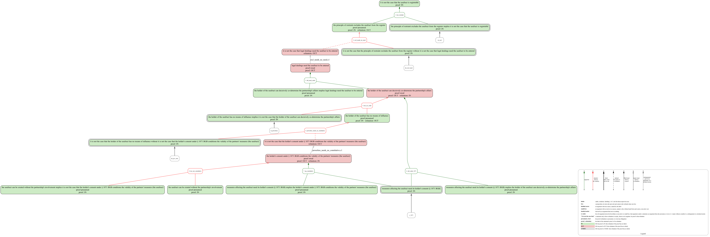
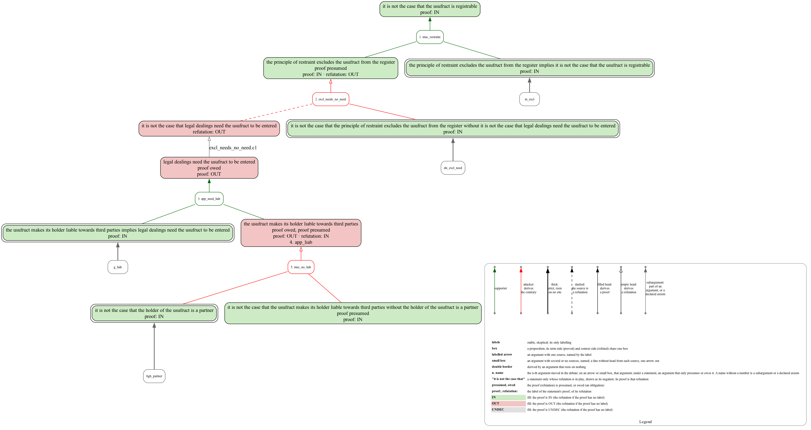
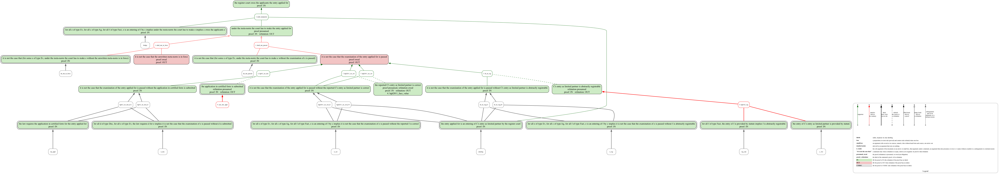
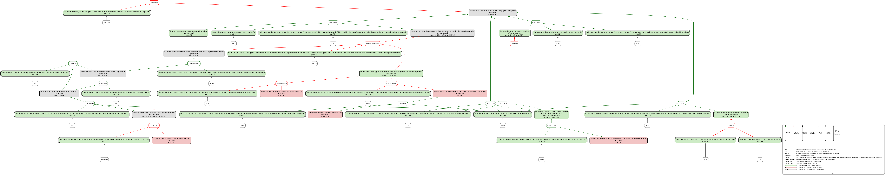

# IRIS follow-up: the examples for the paper

*Generated from `paper-examples.org` by `paper/make_examples.py`; edit the Org file, not this one.*

AI DRAFT (Phase 6 material; `tasks.org`, task `aida-iris-usufruct`). This file
assembles, for each extract of `README.org` (*Extracts for the paper*):

-   the snippet
-   the verdict with its normal form
-   the evaluated term in two renderings: vanilla (the proof term) and the
    English check list (`render ... checklist`)
-   the decorated debate graph, where the extract has a figure

It contains no manuscript prose. The claims each example could support
are those of `README.org`, still for the authors to adopt or reject.

## How the material is made

-   `paper/make_examples.py` tangles the documents, runs each scenario
    with this checkout's Fellowship and writes everything to `paper/out/`.
    Rerun it after any change to the formalisations or to AIDA:
    
        ACDC_FSP=$PWD/wrap/fellowship/fsp .venv/bin/python lib/iris_experiment/paper/make_examples.py

-   Every verdict is computed under the stable semantics, skeptically
    unless marked credulous. The verdicts are the ones `tests/iris/` pins.
-   Each extract also has its German check list (`*.pruefschema.txt`), its
    unfolded check list before evaluation (`*.unfolded.checklist.txt`) and,
    for arguments and issues, its shared form (`*.shared.checklist.txt`).
-   The figures are drawn with `graph ... decorated`: decorated prose in
    the nodes instead of formulae, the labels in words ("proof: IN ·
    refutation: OUT"), and a statement only whose refutation is in play
    drawn as its negation, with its arrows as proofs. The undecorated
    drawings stay in `figures/`.

AI NOTE (reading the check list against the vanilla term):

<table border="2" cellspacing="0" cellpadding="6" rules="groups" frame="hsides">

<colgroup>
<col  class="org-left" />

<col  class="org-left" />
</colgroup>
<thead>
<tr>
<th scope="col" class="org-left">Vanilla</th>
<th scope="col" class="org-left">Check list</th>
</tr>
</thead>
<tbody>
<tr>
<td class="org-left"><code>μx:P.&lt;...&gt;</code></td>
<td class="org-left">"It suffices to check that P. Starting check x:"</td>
</tr>

<tr>
<td class="org-left"><code>μ'x:P.&lt;...&gt;</code></td>
<td class="org-left">"It must be checked whether P. Starting check x:"</td>
</tr>

<tr>
<td class="org-left">bound <code>x</code> at the end</td>
<td class="org-left">"Check x completed (holds)." / "(refuted)."</td>
</tr>

<tr>
<td class="org-left"><code>!IN:P</code> (a delegation, accepted)</td>
<td class="org-left">"unless something speaks against it: P"</td>
</tr>

<tr>
<td class="org-left"><code>?OUT:P</code> (an obligation, failed)</td>
<td class="org-left">"not established: P"</td>
</tr>

<tr>
<td class="org-left"><code>?UNDEC:P</code> / <code>UNDEC:P?</code></td>
<td class="org-left">"undecided: P"</td>
</tr>

<tr>
<td class="org-left">a declared axiom <code>r:P</code></td>
<td class="org-left">"established: P (r)"</td>
</tr>

<tr>
<td class="org-left"><code>t*c</code> (universal instantiation)</td>
<td class="org-left">"instantiating x with t"</td>
</tr>

<tr>
<td class="org-left"><code>(t, v)</code> (existential introduction)</td>
<td class="org-left">"witnessed by t"</td>
</tr>

<tr>
<td class="org-left"><code>_F_</code></td>
<td class="org-left">"contradiction."</td>
</tr>
</tbody>
</table>

## E1 (RQ 3): both outcomes as stable labellings

Fragment (g), the core of the dispute. Credulously, the con reading
(München, Köln) is the labelling that accepts the issue. Skeptically,
the issue is undecided.

    debate con closed frag_g : Registrable [usufruct].
    koe_restraint.
    undermine excl_needs_no_need koe_restraint.
    support old_need_codet excl_needs_no_need.
    support old_codet_1071 old_need_codet.
    attack koe_no_codet old_codet_1071.
    undermine powerless_needs_no_constitutive koe_no_codet.
    support stg_constitutive powerless_needs_no_constitutive.
    attack koe_not_constitutive stg_constitutive.
    cedat tempus.

Credulous:

    frag_g, stable, credulous: value
    μ'koe_restraint:Registrable usufruct.<m_excl:Excluded usufruct->~Registrable usufruct||!IN:Excluded usufruct*μ'b1:~Registrable usufruct.<b1:~Registrable usufruct||koe_restraint:Registrable usufruct*_F_>>

    μ'koe_restraint:Registrable usufruct.<
    ├─ m_excl:Excluded usufruct->~Registrable usufruct||
    └─ !IN:Excluded usufruct*μ'b1:~Registrable usufruct.<
       ├─ b1:~Registrable usufruct||
       └─ koe_restraint:Registrable usufruct*_F_
       >
    >

    It must be checked whether the usufruct is registrable. Starting check koe_restraint:
    ├─ established: the principle of restraint excludes the usufruct from the register implies it is not the case that the usufruct is registrable (m_excl)
    ├─ and
    ├─ unless something speaks against it: the principle of restraint excludes the usufruct from the register
    └─ It must be checked whether it is not the case that the usufruct is registrable. Starting check b1:
       ├─ Check b1 completed (refuted).
       ├─ and
       ├─ Check koe_restraint completed (refuted).
       └─ contradiction.

Skeptical:

    undecided: the usufruct is registrable

## E2 (RQ 3): refutation as burden allocation

Fragment (a): München only rebuts the grounds offered, and still
decides, because the restraint is presumed.

    debate con closed frag_a : Registrable [usufruct].
    muc_restraint.
    undermine excl_needs_no_need muc_restraint.
    support app_need_liab excl_needs_no_need.
    support app_liab app_need_liab.
    attack muc_no_liab app_liab.
    cedat tempus.

    frag_a, stable, skeptical: value
    μ'muc_restraint:Registrable usufruct.<m_excl:Excluded usufruct->~Registrable usufruct||!IN:Excluded usufruct*μ'b1:~Registrable usufruct.<b1:~Registrable usufruct||muc_restraint:Registrable usufruct*_F_>>

    μ'muc_restraint:Registrable usufruct.<
    ├─ m_excl:Excluded usufruct->~Registrable usufruct||
    └─ !IN:Excluded usufruct*μ'b1:~Registrable usufruct.<
       ├─ b1:~Registrable usufruct||
       └─ muc_restraint:Registrable usufruct*_F_
       >
    >

    It must be checked whether the usufruct is registrable. Starting check muc_restraint:
    ├─ established: the principle of restraint excludes the usufruct from the register implies it is not the case that the usufruct is registrable (m_excl)
    ├─ and
    ├─ unless something speaks against it: the principle of restraint excludes the usufruct from the register
    └─ It must be checked whether it is not the case that the usufruct is registrable. Starting check b1:
       ├─ Check b1 completed (refuted).
       ├─ and
       ├─ Check muc_restraint completed (refuted).
       └─ contradiction.

## E3 (RQ 4): the gap as a delegation

The meta-norm delegated (4a) against owed (4b). The two scripts differ
in one line, `by default.` at the meta-norm.

Delegated (block `draft_metanorm`):

    argument draft_metanorm : (Duty [court] [app] [e1]).
    cut (forall e:Ev, forall c:Ag, forall f:Fact, Enter [e] [c] [f] -> MetaNorm [e] -> Duty [c] [app] [e]) r.
    axiom bridge.
    elim [e1].
    elim [court].
    elim [kp_c].
    elim.
    axiom entering.
    elim.
    by default.
    next.
    axiom r.
    dixi.

    draft_metanorm, stable, skeptical: value
    μdraft_metanorm:Duty court app e1.<bridge:forall e:Ev,forall c:Ag,forall f:Fact,Enter e c f->MetaNorm e->Duty c app e||e1*court*kp_c*entering:Enter e1 court kp_c*!IN:MetaNorm e1*draft_metanorm:Duty court app e1>

    It suffices to check that the register court owes the applicants the entry applied for. Starting check draft_metanorm:
    ├─ established: for all e of type Ev, for all c of type Ag, for all f of type Fact, e is an entering of f by c implies under the meta-norm the court has to make e implies c owes the applicants e (bridge)
    ├─ instantiating e with the entry applied for
    ├─ instantiating c with the register court
    ├─ instantiating f with C's entry as limited partner
    ├─ and
    ├─ established: the entry applied for is an entering of C's entry as limited partner by the register court (entering)
    ├─ and
    ├─ unless something speaks against it: under the meta-norm the court has to make the entry applied for
    └─ Check draft_metanorm completed (holds).

Owed (block `draft_metanorm_owed`):

    argument draft_metanorm : (Duty [court] [app] [e1]).
    cut (forall e:Ev, forall c:Ag, forall f:Fact, Enter [e] [c] [f] -> MetaNorm [e] -> Duty [c] [app] [e]) r.
    axiom bridge.
    elim [e1].
    elim [court].
    elim [kp_c].
    elim.
    axiom entering.
    elim.
    next.
    axiom r.
    dixi.

    draft_metanorm, stable, skeptical: open
    ?OUT:Duty court app e1

    not established: the register court owes the applicants the entry applied for

## E4 (RQ 6): the burden of proof per requirement

Complete application (6a), missing document (6b), justified doubt (6c).

    declare n_reg : (forall e:Ev, forall c:Ag, forall f:Fact, Enter [e] [c] [f] -> ~(Passed [e] - Registrable [f])).
    declare n_doc : (forall d:Doc, forall e:Ev, Required [d] [e] -> ~(Passed [e] - Submitted [d])).
    declare n_cor : (forall e:Ev, forall c:Ag, forall f:Fact, Enter [e] [c] [f] -> ~(Passed [e] - Correct [f])).
    
    argument bgh2011_face_value : (Correct [?f]).
    by default.
    dixi.
    
    counterargument lit_no_reg : (Passed [e1]).
    cut (Passed [e1] - Registrable [kp_c]) th.
    elim.
    by default.
    next.
    axiom th.
    cut (forall e:Ev, forall c:Ag, forall f:Fact, Enter [e] [c] [f] -> ~(Passed [e] - Registrable [f])) r.
    axiom n_reg.
    elim [e1].
    elim [court].
    elim [kp_c].
    elim.
    axiom entering.
    elim.
    axiom.
    dixi.
    
    counterargument hgb12_no_doc : (Passed [e1]).
    cut (Passed [e1] - Submitted [d_appl]) th.
    elim.
    by default.
    next.
    axiom th.
    cut (forall d:Doc, forall e:Ev, Required [d] [e] -> ~(Passed [e] - Submitted [d])) r.
    axiom n_doc.
    elim [d_appl].
    elim [e1].
    elim.
    axiom req_appl.
    elim.
    axiom.
    dixi.
    
    counterargument bgh2011_no_cor : (Passed [e1]).
    cut (Passed [e1] - Correct [kp_c]) th.
    elim.
    next.
    axiom th.
    cut (forall e:Ev, forall c:Ag, forall f:Fact, Enter [e] [c] [f] -> ~(Passed [e] - Correct [f])) r.
    axiom n_cor.
    elim [e1].
    elim [court].
    elim [kp_c].
    elim.
    axiom entering.
    elim.
    axiom.
    dixi.
    
    argument hgb162_reg : (Registrable [kp_c]).
    cut (forall f:Fact, ProvidedByStatute [f] -> Registrable [f]) r.
    axiom reg_stat.
    elim [kp_c].
    elim.
    axiom s_162.
    axiom r.
    dixi.

Complete application:

    draft_metanorm, stable, skeptical: value
    μdraft_metanorm:Duty court app e1.<bridge:forall e:Ev,forall c:Ag,forall f:Fact,Enter e c f->MetaNorm e->Duty c app e||e1*court*kp_c*entering:Enter e1 court kp_c*!IN:MetaNorm e1*draft_metanorm:Duty court app e1>

    It suffices to check that the register court owes the applicants the entry applied for. Starting check draft_metanorm:
    ├─ established: for all e of type Ev, for all c of type Ag, for all f of type Fact, e is an entering of f by c implies under the meta-norm the court has to make e implies c owes the applicants e (bridge)
    ├─ instantiating e with the entry applied for
    ├─ instantiating c with the register court
    ├─ instantiating f with C's entry as limited partner
    ├─ and
    ├─ established: the entry applied for is an entering of C's entry as limited partner by the register court (entering)
    ├─ and
    ├─ unless something speaks against it: under the meta-norm the court has to make the entry applied for
    └─ Check draft_metanorm completed (holds).

Missing document:

    draft_metanorm, stable, skeptical: open
    ?OUT:Duty court app e1

Justified doubt (block `bgh2011_doubt`):

    declare reg_conflict : (Conflict [kp_c]).
    counterargument bgh2011_doubt : (Correct [kp_c]).
    cut (Conflict [kp_c] -> ~Correct [kp_c]) r.
    by default.
    next.
    elim.
    axiom reg_conflict.
    elim.
    axiom.
    dixi.

    draft_metanorm, stable, skeptical: open
    ?OUT:Duty court app e1

AI NOTE: an open verdict's normal form is the one site that failed, so
its evaluated rendering is a single line. What the court must ask for
is in the unfolded check list (`E4-6b-missing.unfolded.checklist.txt`,
96 lines), from which an excerpt would be needed for the paper.

## E5 (RQ 7): the circle between claim and scope of examination

The cycle alone (7a), and anchored by the unwritten normative scope (7b).

    declare corr1 : (forall a:Ag, forall b:Ag, forall e:Ev, Duty [b] [a] [e] -> Claim [a] [b] [e]).
    declare corr2 : (forall a:Ag, forall b:Ag, forall e:Ev, Claim [a] [b] [e] -> Duty [b] [a] [e]).
    declare n_dem : (forall d:Doc, forall e:Ev, Demanded [d] [e] -> Proper [d] [e] -> ~(Passed [e] - Submitted [d])).
    declare bgh_rule : (forall a:Ag, forall c:Ag, forall e:Ev, Claim [a] [c] [e] -> Limited [e]).
    declare scope_rule : (forall d:Doc, forall e:Ev, Limited [e] -> Applies [d] [e] -> ~Proper [d] [e]).
    declare req_exc : (forall d:Doc, forall e:Ev, Required [d] [e] -> ~Applies [d] [e]).
    declare ind_exc : (forall d:Doc, forall e:Ev, Indicated [e] -> ~Applies [d] [e]).
    declare ind_rule : (forall f:Fact, forall e:Ev, forall c:Ag, Enter [e] [c] [f] -> Conflict [f] -> Indicated [e]).
    declare dem : (Demanded [d_contract] [e1]).
    declare flaw_rule : (forall d:Doc, forall f:Fact, Flaw [d] [f] -> ~Correct [f]).
    
    argument lit_corr_claim : (Claim [app] [court] [e1]).
    cut (forall a:Ag, forall b:Ag, forall e:Ev, Duty [b] [a] [e] -> Claim [a] [b] [e]) r.
    axiom corr1.
    elim [app].
    elim [court].
    elim [e1].
    elim.
    next.
    axiom r.
    dixi.
    
    argument lit_corr_duty : (Duty [court] [app] [e1]).
    cut (forall a:Ag, forall b:Ag, forall e:Ev, Claim [a] [b] [e] -> Duty [b] [a] [e]) r.
    axiom corr2.
    elim [app].
    elim [court].
    elim [e1].
    elim.
    next.
    axiom r.
    dixi.
    
    counterargument case_court_extra : (Passed [e1]).
    cut (Passed [e1] - Submitted [d_contract]) th.
    elim.
    by default.
    next.
    axiom th.
    cut (forall d:Doc, forall e:Ev, Demanded [d] [e] -> Proper [d] [e] -> ~(Passed [e] - Submitted [d])) r.
    axiom n_dem.
    elim [d_contract].
    elim [e1].
    elim.
    axiom dem.
    elim.
    by default.
    next.
    elim.
    axiom.
    dixi.
    
    counterargument case_court_flaw : (Correct [kp_c]).
    cut (forall d:Doc, forall f:Fact, Flaw [d] [f] -> ~Correct [f]) r.
    axiom flaw_rule.
    elim [d_contract].
    elim [kp_c].
    elim.
    next.
    elim.
    axiom.
    dixi.
    
    argument bgh1991_claim_limits : (Limited [e1]).
    cut (forall a:Ag, forall c:Ag, forall e:Ev, Claim [a] [c] [e] -> Limited [e]) r.
    axiom bgh_rule.
    elim [app].
    elim [court].
    elim [e1].
    elim.
    next.
    axiom r.
    dixi.
    
    counterargument bgh1991_improper_demand : (Proper [d_contract] [e1]).
    cut (forall d:Doc, forall e:Ev, Limited [e] -> Applies [d] [e] -> ~Proper [d] [e]) r.
    axiom scope_rule.
    elim [d_contract].
    elim [e1].
    elim.
    next.
    elim.
    by default.
    next.
    elim.
    axiom.
    dixi.
    
    counterargument case_court_required : (Applies [d_contract] [e1]).
    cut (forall d:Doc, forall e:Ev, Required [d] [e] -> ~Applies [d] [e]) r.
    axiom req_exc.
    elim [d_contract].
    elim [e1].
    elim.
    next.
    elim.
    axiom.
    dixi.
    
    counterargument bgh1991_indication : (Applies [d_contract] [e1]).
    cut (forall d:Doc, forall e:Ev, Indicated [e] -> ~Applies [d] [e]) r.
    axiom ind_exc.
    elim [d_contract].
    elim [e1].
    elim.
    next.
    elim.
    axiom.
    dixi.
    
    argument case_indication : (Indicated [e1]).
    cut (forall f:Fact, forall e:Ev, forall c:Ag, Enter [e] [c] [f] -> Conflict [f] -> Indicated [e]) r.
    axiom ind_rule.
    elim [kp_c].
    elim [e1].
    elim [court].
    elim.
    axiom entering.
    elim.
    next.
    axiom r.
    dixi.

    lit_corr_claim, stable, skeptical: open
    ?UNDEC:Claim app court e1

    undecided: the applicants can claim the entry applied for from the register court

Anchored (block `scope_principle`):

    argument karlsruhe2001_scope : (Limited [e1]).
    by default.
    dixi.

    lit_corr_claim, stable, skeptical: value
    μlit_corr_claim:Claim app court e1.<corr1:forall a:Ag,forall b:Ag,forall e:Ev,Duty b a e->Claim a b e||app*court*e1*μb1:Duty court app e1.<bridge:forall e:Ev,forall c:Ag,forall f:Fact,Enter e c f->MetaNorm e->Duty c app e||e1*court*kp_c*entering:Enter e1 court kp_c*!IN:MetaNorm e1*b1:Duty court app e1>*lit_corr_claim:Claim app court e1>

    μlit_corr_claim:Claim app court e1.<
    ├─ corr1:forall a:Ag,forall b:Ag,forall e:Ev,Duty b a e->Claim a b e||
    └─ app*court*e1*μb1:Duty court app e1.<
       ├─ bridge:forall e:Ev,forall c:Ag,forall f:Fact,Enter e c f->MetaNorm e->Duty c app e||
       └─ e1*court*kp_c*entering:Enter e1 court kp_c*!IN:MetaNorm e1*b1:Duty court app e1
       >
       *lit_corr_claim:Claim app court e1
    >

    It suffices to check that the applicants can claim the entry applied for from the register court. Starting check lit_corr_claim:
    ├─ established: for all a of type Ag, for all b of type Ag, for all e of type Ev, b owes a e implies a can claim e from b (corr1)
    ├─ instantiating a with the applicants
    ├─ instantiating b with the register court
    ├─ instantiating e with the entry applied for
    ├─ and
    ├─ It suffices to check that the register court owes the applicants the entry applied for. Starting check b1:
    │  ├─ established: for all e of type Ev, for all c of type Ag, for all f of type Fact, e is an entering of f by c implies under the meta-norm the court has to make e implies c owes the applicants e (bridge)
    │  ├─ instantiating e with the entry applied for
    │  ├─ instantiating c with the register court
    │  ├─ instantiating f with C's entry as limited partner
    │  ├─ and
    │  ├─ established: the entry applied for is an entering of C's entry as limited partner by the register court (entering)
    │  ├─ and
    │  ├─ unless something speaks against it: under the meta-norm the court has to make the entry applied for
    │  └─ Check b1 completed (holds).
    └─ Check lit_corr_claim completed (holds).

## E9 (RQ 6, "verarbeiten"): the court's order as the evaluation's output

### A declared order (6p-b: the application is missing)

    declare Order : type.
    declare o_submit, o_prove, o_entry : Order.
    declare Lawful : Order -> bool.
    decorate o_entry : "the entry of C as limited partner".
    decorate o_submit : "an interim order to submit the application in certified form".
    decorate o_prove : "an interim order to clear the doubt the register raises".
    decorate Lawful : "@arg1 is the lawful order".
    declare entry_rule : (Duty [court] [app] [e1] -> Lawful [o_entry]).
    declare submitted_moot_rule : (Submitted [d_appl] -> ~Lawful [o_submit]).
    declare no_delay_submit_rule : (Duty [court] [app] [e1] -> ~Lawful [o_submit]).
    declare no_delay_prove_rule : (Duty [court] [app] [e1] -> ~Lawful [o_prove]).
    
    argument lawful_entry : (Lawful [o_entry]).
    cut (Duty [court] [app] [e1] -> Lawful [o_entry]) r.
    axiom entry_rule.
    elim.
    next.
    axiom r.
    dixi.
    
    argument lawful_submit : (Lawful [o_submit]).
    by default.
    dixi.
    
    counterargument submitted_moots : (Lawful [o_submit]).
    cut (Submitted [d_appl] -> ~Lawful [o_submit]) r.
    axiom submitted_moot_rule.
    elim.
    next.
    elim.
    axiom.
    dixi.
    
    counterargument no_delay_submit : (Lawful [o_submit]).
    cut (Duty [court] [app] [e1] -> ~Lawful [o_submit]) r.
    axiom no_delay_submit_rule.
    elim.
    next.
    elim.
    axiom.
    dixi.
    
    argument lawful_prove : (Lawful [o_prove]).
    cut (Conflict [kp_c] -> Lawful [o_prove]) r.
    by default.
    next.
    elim.
    next.
    axiom r.
    dixi.
    
    counterargument no_delay_prove : (Lawful [o_prove]).
    cut (Duty [court] [app] [e1] -> ~Lawful [o_prove]) r.
    axiom no_delay_prove_rule.
    elim.
    next.
    elim.
    axiom.
    dixi.
    
    argument decision : [?o:Order] (exists o:Order, Lawful [o]).
    elim [?o].
    dixi.

    decision, stable, skeptical: value
    μdecision:exists o:Order,Lawful o.<(o_submit,!IN:Lawful o_submit)||decision:exists o:Order,Lawful o>

    μdecision:exists o:Order,Lawful o.<
    ├─ (o_submit,!IN:Lawful o_submit)||
    └─ decision:exists o:Order,Lawful o
    >

    It suffices to check that for some o of type Order, o is the lawful order. Starting check decision:
    ├─ witnessed by an interim order to submit the application in certified form
    ├─ unless something speaks against it: an interim order to submit the application in certified form is the lawful order
    └─ Check decision completed (holds).

### The order computed from a finding (6w-b, constructive)

    declare Order : type.
    declare interim : Doc -> Order.
    declare Missing : Doc -> bool.
    declare Lawful : Order -> bool.
    decorate interim : "an interim order to submit @arg1".
    decorate Missing : "@arg1 is missing".
    decorate Lawful : "@arg1 is the lawful order".
    declare interim_rule : (forall d:Doc, Missing [d] -> Lawful [interim d]).
    declare submitted_not_missing : (forall d:Doc, Submitted [d] -> ~Missing [d]).
    
    # The court's finding: some document the law requires is missing.
    argument finding : (exists d:Doc, Missing [d]).
    elim [d_appl].
    by default.
    dixi.
    
    counterargument finding_moot : (Missing [d_appl]).
    cut (forall d:Doc, Submitted [d] -> ~Missing [d]) r.
    axiom submitted_not_missing.
    elim [d_appl].
    elim.
    next.
    elim.
    axiom.
    dixi.
    
    # The decision never names a document: it opens the finding and builds the order from it.
    argument decision_c : (exists o:Order, Lawful [o]).
    cut (exists d:Doc, Missing [d]) m.
    next.
    elim.
    cut (exists o:Order, Lawful [o]) k.
    elim [interim d].
    cut (forall d:Doc, Missing [d] -> Lawful [interim d]) r.
    axiom interim_rule.
    elim [d].
    elim.
    axiom.
    axiom r.
    axiom m.
    dixi.

    decision_c, stable, skeptical: value
    μdecision_c:exists o:Order,Lawful o.<(interim d_appl,μb3:Lawful (interim d_appl).<interim_rule:forall d:Doc,Missing d->Lawful (interim d)||d_appl*!IN:Missing d_appl*b3:Lawful (interim d_appl)>)||decision_c:exists o:Order,Lawful o>

    μdecision_c:exists o:Order,Lawful o.<
    ├─ (interim d_appl,μb3:Lawful (interim d_appl).<
    │  ├─ interim_rule:forall d:Doc,Missing d->Lawful (interim d)||
    │  └─ d_appl*!IN:Missing d_appl*b3:Lawful (interim d_appl)
    │  >
    │  )||
    └─ decision_c:exists o:Order,Lawful o
    >

    It suffices to check that for some o of type Order, o is the lawful order. Starting check decision_c:
    ├─ witnessed by an interim order to submit the application in certified form
    ├─ It suffices to check that an interim order to submit the application in certified form is the lawful order. Starting check b3:
    │  ├─ established: for all d of type Doc, d is missing implies an interim order to submit d is the lawful order (interim_rule)
    │  ├─ instantiating d with the application in certified form
    │  ├─ and
    │  ├─ unless something speaks against it: the application in certified form is missing
    │  └─ Check b3 completed (holds).
    └─ Check decision_c completed (holds).

### The order from an argued case split (6k-b, classical)

    declare Order : type.
    declare o_submit, o_entry : Order.
    declare Lawful : Order -> bool.
    decorate o_entry : "the entry of C as limited partner".
    decorate o_submit : "an interim order to remedy the application".
    decorate Lawful : "@arg1 is the lawful order".
    declare entry_rule : (Duty [court] [app] [e1] -> Lawful [o_entry]).
    declare remedy_rule : ((Duty [court] [app] [e1] -> false) -> Lawful [o_submit]).
    
    # Peirce at the duty, argued: its open site is "the entry is not owed".
    argument peirce_duty : (((Duty [court] [app] [e1] -> false) -> Duty [court] [app] [e1]) -> Duty [court] [app] [e1]).
    elim f.
    cut ((Duty [court] [app] [e1] -> false) -> Duty [court] [app] [e1]) g.
    axiom f.
    elim.
    by default.
    next.
    axiom g.
    dixi.
    
    # First witness the entry order; to show the duty, assume it is not owed
    # and offer the claim again with the submission order.
    argument decision_k : (exists o:Order, Lawful [o]).
    elim [o_entry].
    cut (Duty [court] [app] [e1] -> Lawful [o_entry]) r.
    axiom entry_rule.
    elim.
    cut (((Duty [court] [app] [e1] -> false) -> Duty [court] [app] [e1]) -> Duty [court] [app] [e1]) p.
    next.
    elim.
    elim n.
    cut (exists o:Order, Lawful [o]) k.
    elim [o_submit].
    cut ((Duty [court] [app] [e1] -> false) -> Lawful [o_submit]) s.
    axiom remedy_rule.
    elim.
    axiom n.
    axiom s.
    next.
    axiom p.
    axiom r.
    dixi.

    decision_k, stable, skeptical: value
    μalt16:exists o:Order,Lawful o.<(o_submit,μb1:Lawful o_submit.<remedy_rule:(Duty court app e1->false)->Lawful o_submit||!IN:Duty court app e1->false*b1:Lawful o_submit>)||alt16:exists o:Order,Lawful o>

    μalt16:exists o:Order,Lawful o.<
    ├─ (o_submit,μb1:Lawful o_submit.<
    │  ├─ remedy_rule:(Duty court app e1->false)->Lawful o_submit||
    │  └─ !IN:Duty court app e1->false*b1:Lawful o_submit
    │  >
    │  )||
    └─ alt16:exists o:Order,Lawful o
    >

    It suffices to check that for some o of type Order, o is the lawful order. Starting check alt16:
    ├─ witnessed by an interim order to remedy the application
    ├─ For an interim order to remedy the application is the lawful order it suffices that the register court owes the applicants the entry applied for implies false holds. Starting check b1:
    │  ├─ because
    │  │  └─ established: the register court owes the applicants the entry applied for implies false implies an interim order to remedy the application is the lawful order (remedy_rule)
    │  ├─ and
    │  │  └─ unless something speaks against it: the register court owes the applicants the entry applied for implies false
    │  └─ Check b1 completed.
    └─ Check alt16 completed (holds).

## S (RQ 3, presentation): sharing abridges a large debate

The four decisions in one document, the issue `Registrable usufruct`
unfolded. Expanded, its check list has 34,065 lines. Shared
(`render issue :Registrable[usufruct] checklist shared`), it has 1,133
lines: 12 named sub-debates, each printed once, and 38 citations of
them. The figures are in `paper/out/SUMMARY.txt`.

The opening of the shared form:

    It suffices to check that the usufruct is registrable. Starting check alt6:
    ├─ It suffices to check that the usufruct is registrable. Starting check alt1:
    │  ├─ otherwise not established: the usufruct is registrable
    │  └─ Against the usufruct is registrable:
    │     │  └─ Check alt1 completed (holds).
    │     └─ but
    │        └─ It suffices to check that the usufruct is registrable. Starting check alt5:
    │           ├─ It suffices to check that the usufruct is registrable. Starting check alt4:
    │           │  ├─ It suffices to check that the usufruct is registrable. Starting check alt3:
    │           │  │  ├─ It suffices to check that the usufruct is registrable. Starting check alt2:
    │           │  │  │  ├─ It suffices to check that the usufruct is registrable. Starting check stg_registrable:
    │           │  │  │  │  ├─ For the usufruct is registrable it suffices that legal dealings need the usufruct to be entered holds. Starting check r:
    │           │  │  │  │  │  ├─ because
    │           │  │  │  │  │  │  └─ established: legal dealings need the usufruct to be entered implies the usufruct is registrable (m_need)
    │           │  │  │  │  │  ├─ and
    │           │  │  │  │  │  │  └─ see check anon_1: legal dealings need the usufruct to be entered
    │           │  │  │  │  │  └─ Check r completed.
    │           │  │  │  │  └─ Check stg_registrable completed (holds).
    │           │  │  │  └─ Against the usufruct is registrable:
    │           │  │  │     │  └─ Check alt2 completed (holds).
    │           │  │  │     └─ but
    │           │  │  │        └─ It suffices to check that the usufruct is registrable. Starting check stg_analogy:
    │           │  │  │           ├─ It suffices to check that the usufruct is registrable. Starting check r_2:
    │           │  │  │           │  ├─ established: the long-term executorship over a limited partner's estate is registrable implies the usufruct shares the features for which the executorship was held registrable implies the usufruct is registrable (analogy_exec)
    │           │  │  │           │  ├─ and
    │           │  │  │           │  ├─ established: the long-term executorship over a limited partner's estate is registrable (bgh_exec_reg)
    │           │  │  │           │  ├─ and
    │           │  │  │           │  ├─ see check anon_2: the usufruct shares the features for which the executorship was held registrable
    │           │  │  │           │  └─ Check r_2 completed (holds).
    │           │  │  │           └─ Check stg_analogy completed (holds).
    │           │  │  └─ Against the usufruct is registrable:
    │           │  │     │  └─ Check alt3 completed (holds).
    │           │  │     └─ but
    │           │  │        └─ It suffices to check that the usufruct is registrable. Starting check old_registrable:
    │           │  │           ├─ For the usufruct is registrable it suffices that legal dealings need the usufruct to be entered holds. Starting check r_3:
    │           │  │           │  ├─ because
    │           │  │           │  │  └─ established: legal dealings need the usufruct to be entered implies the usufruct is registrable (m_need)
    │           │  │           │  ├─ and
    │           │  │           │  │  └─ see check anon_1: legal dealings need the usufruct to be entered

AI NOTE: the expanded file is not kept in the repository (9.7 MB,
`paper/.gitignore`). `make_examples.py` rewrites it.

## E6, E7, E8

These extracts are tables and courses of verdicts rather than single
terms: E6 is `evaluation/comparison.org`, E7 is
`rq3-debate-dynamics.org` and E8 is `rq4-gap-dynamics.org`. They need no
rendering.

