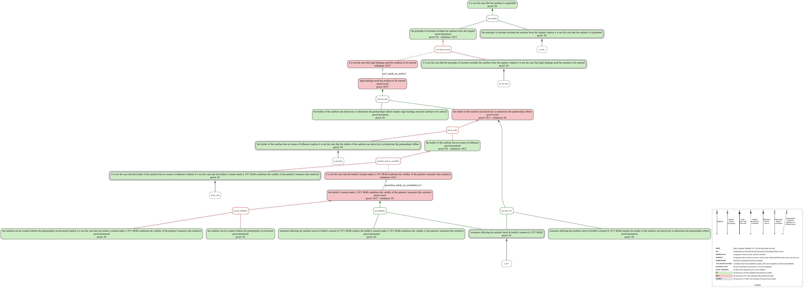
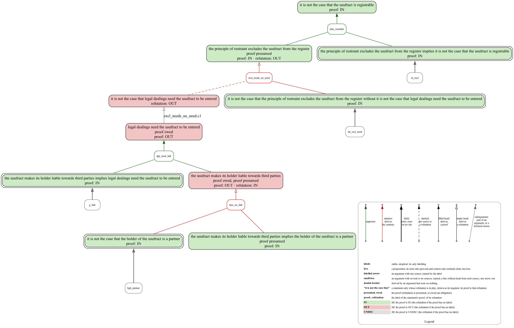
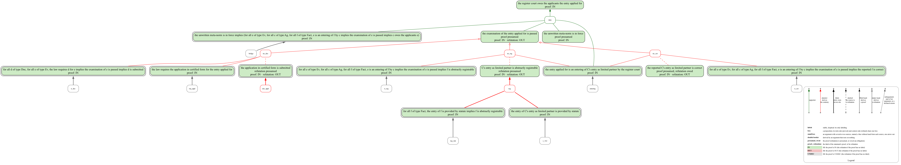
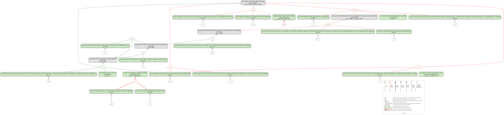

#+title: IRIS follow-up: the examples for the paper
#+language: en
#+html_head: 

AI DRAFT (Phase 6 material; =tasks.org=, task =aida-iris-usufruct=). This file
assembles, for each extract of =README.org= (/Extracts for the paper/):
- the snippet
- the verdict with its normal form
- the evaluated term in two renderings: vanilla (the proof term) and the
  English check list (=render ... checklist=)
- the decorated debate graph, where the extract has a figure

It contains no manuscript prose. The claims each example could support
are those of =README.org=, still for the authors to adopt or reject.

* How the material is made

- =paper/make_examples.py= tangles the documents, runs each scenario
  with this checkout's Fellowship and writes everything to =paper/out/=.
  Rerun it after any change to the formalisations or to AIDA:

  #+begin_src sh
  ACDC_FSP=$PWD/wrap/fellowship/fsp .venv/bin/python lib/iris_experiment/paper/make_examples.py
  #+end_src

- Every verdict is computed under the stable semantics, skeptically
  unless marked credulous. The verdicts are the ones =tests/iris/= pins.
- Each extract also has its German check list (=*.pruefschema.txt=), its
  unfolded check list before evaluation (=*.unfolded.checklist.txt=) and,
  for arguments and issues, its shared form (=*.shared.checklist.txt=).
- The figures are drawn with =graph ... decorated=: decorated prose in
  the nodes instead of formulae, the labels in words ("proof: IN ·
  refutation: OUT"), and a statement only whose refutation is in play
  drawn as its negation, with its arrows as proofs. The undecorated
  drawings stay in =figures/=.

AI NOTE (reading the check list against the vanilla term):

| Vanilla                         | Check list                                          |
|---------------------------------+-----------------------------------------------------|
| =μx:P.<...>=                    | "It suffices to check that P. Starting check x:"    |
| =μ'x:P.<...>=                   | "It must be checked whether P. Starting check x:"   |
| bound =x= at the end            | "Check x completed (holds)." / "(refuted)."         |
| =!IN:P= (a delegation, accepted) | "unless something speaks against it: P"            |
| =?OUT:P= (an obligation, failed) | "not established: P"                               |
| =?UNDEC:P= / =UNDEC:P?=         | "undecided: P"                                      |
| a declared axiom =r:P=          | "established: P (r)"                                |
| =t*c= (universal instantiation) | "instantiating x with t"                            |
| =(t, v)= (existential introduction) | "witnessed by t"                                |
| =_F_=                           | "contradiction."                                    |

* E1 (RQ 3): both outcomes as stable labellings

Fragment (g), the core of the dispute. Credulously, the con reading
(München, Köln) is the labelling that accepts the issue. Skeptically,
the issue is undecided.

#+include: "paper/out/E1-frag_g-credulous.fspy" src fspy

Credulous:
#+include: "paper/out/E1-frag_g-credulous.verdict.txt" example
#+include: "paper/out/E1-frag_g-credulous.vanilla.txt" example
#+include: "paper/out/E1-frag_g-credulous.checklist.txt" example

Skeptical:
#+include: "paper/out/E1-frag_g-skeptical.checklist.txt" example

* E2 (RQ 3): refutation as burden allocation

Fragment (a): München only rebuts the grounds offered, and still
decides, because the restraint is presumed.

#+include: "paper/out/E2-frag_a.fspy" src fspy
#+include: "paper/out/E2-frag_a.verdict.txt" example
#+include: "paper/out/E2-frag_a.vanilla.txt" example
#+include: "paper/out/E2-frag_a.checklist.txt" example

* E3 (RQ 4): the gap as a delegation

The meta-norm delegated (4a) against owed (4b). The two scripts differ
in one line, =by default.= at the meta-norm.

Delegated (block =duty=):
#+include: "paper/out/E3-4a-delegated.fspy" src fspy
#+include: "paper/out/E3-4a-delegated.verdict.txt" example
#+include: "paper/out/E3-4a-delegated.checklist.txt" example

Owed (block =duty_owed=):
#+include: "paper/out/E3-4b-owed.fspy" src fspy
#+include: "paper/out/E3-4b-owed.verdict.txt" example
#+include: "paper/out/E3-4b-owed.checklist.txt" example

* E4 (RQ 6): the burden of proof per requirement

Complete application (6a), missing document (6b), justified doubt (6c).

#+include: "paper/out/E4-6a-complete.fspy" src fspy

Complete application:
#+include: "paper/out/E4-6a-complete.verdict.txt" example
#+include: "paper/out/E4-6a-complete.checklist.txt" example

Missing document:
#+include: "paper/out/E4-6b-missing.verdict.txt" example

Justified doubt (block =doubt=):
#+include: "paper/out/E4-6c-doubt.fspy" src fspy
#+include: "paper/out/E4-6c-doubt.verdict.txt" example

AI NOTE: an open verdict's normal form is the one site that failed, so
its evaluated rendering is a single line. What the court must ask for
is in the unfolded check list (=E4-6b-missing.unfolded.checklist.txt=,
96 lines), from which an excerpt would be needed for the paper.

* E5 (RQ 7): the circle between claim and scope of examination

The cycle alone (7a), and anchored by the unwritten normative scope (7b).

#+include: "paper/out/E5-7a-circle.fspy" src fspy
#+include: "paper/out/E5-7a-circle.verdict.txt" example
#+include: "paper/out/E5-7a-circle.checklist.txt" example

Anchored (block =scope_principle=):
#+include: "paper/out/E5-7b-anchored.fspy" src fspy
#+include: "paper/out/E5-7b-anchored.verdict.txt" example
#+include: "paper/out/E5-7b-anchored.vanilla.txt" example
#+include: "paper/out/E5-7b-anchored.checklist.txt" example

* E9 (RQ 6, "verarbeiten"): the court's order as the evaluation's output

** A declared order (6p-b: the application is missing)

#+include: "paper/out/E9-6p-b-order.fspy" src fspy
#+include: "paper/out/E9-6p-b-order.verdict.txt" example
#+include: "paper/out/E9-6p-b-order.vanilla.txt" example
#+include: "paper/out/E9-6p-b-order.checklist.txt" example

** The order computed from a finding (6w-b, constructive)

#+include: "paper/out/E9-6w-b-constructive.fspy" src fspy
#+include: "paper/out/E9-6w-b-constructive.verdict.txt" example
#+include: "paper/out/E9-6w-b-constructive.vanilla.txt" example
#+include: "paper/out/E9-6w-b-constructive.checklist.txt" example

** The order from an argued case split (6k-b, classical)

#+include: "paper/out/E9-6k-b-classical.fspy" src fspy
#+include: "paper/out/E9-6k-b-classical.verdict.txt" example
#+include: "paper/out/E9-6k-b-classical.vanilla.txt" example
#+include: "paper/out/E9-6k-b-classical.checklist.txt" example

* S (RQ 3, presentation): sharing abridges a large debate

The four decisions in one document, the issue =Registrable usufruct=
unfolded. Expanded, its check list has 34,065 lines. Shared
(=render issue :Registrable[usufruct] checklist shared=), it has 1,133
lines: 12 named sub-debates, each printed once, and 38 citations of
them. The figures are in =paper/out/SUMMARY.txt=.

The opening of the shared form:
#+include: "paper/out/S-combined.shared.checklist.txt" example :lines "1-40"

AI NOTE: the expanded file is not kept in the repository (9.7 MB,
=paper/.gitignore=). =make_examples.py= rewrites it.

* E6, E7, E8

These extracts are tables and courses of verdicts rather than single
terms: E6 is =evaluation/comparison.org=, E7 is
=rq3-debate-dynamics.org= and E8 is =rq4-gap-dynamics.org=. They need no
rendering.
